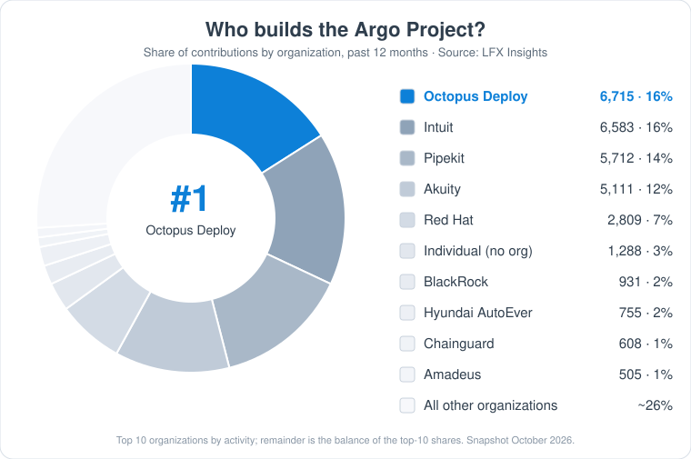

  <picture>
    <source media="(prefers-color-scheme: dark)" srcset="assets/octopus-logo-dark.svg">
    
  </picture>

<h1 align="center">Octopus Deploy Open Source</h1>

  The open source projects we build, maintain, and contribute to. 
  From the <a href="https://argoproj.github.io/">Argo Project</a> to the tools that power <a href="https://octopus.com">Octopus Deploy</a>, find them all here.

  <a href="https://insights.linuxfoundation.org/project/argo/contributors"><b>🥇 #1 contributing organization to the Argo Project</b></a> 
  6,715 contributions in the past 12 months (16% of all activity), ahead of Intuit, Pipekit, Akuity and Red Hat. Source: LFX Insights.

  

<table align="center">
  <tr>
    <td align="center"><b>#1</b> contributing org to Argo (LFX Insights, past 12 months)</td>
    <td align="center"><b>28,000+</b> GitHub stars across Argo CD, Rollouts & plugins</td>
    <td align="center"><b>2,500+</b> contributors to Argo CD & Argo Rollouts</td>
    <td align="center"><b>14,000+</b> commits in Argo CD & Argo Rollouts</td>
    <td align="center"><b>100+</b> public repos in the Octopus Deploy org</td>
  </tr>
</table>

Snapshot as of October 2026. Counts come from the GitHub API and LFX Insights and are not auto-updated.

<a href="https://insights.linuxfoundation.org/project/argo/"><b>📊 See live Argo Project contribution stats on LFX Insights →</b></a>

---

##  Argo Project & GitOps

Octopus Deploy is the top contributing organization to the [Argo Project](https://argoproj.github.io/) (a CNCF graduated project, valued by LFX at $188M of software), and our engineers maintain core parts of it and help steer the GitOps standards behind it. See the [LFX Insights dashboard](https://insights.linuxfoundation.org/project/argo/) for live contribution, contributor, and community-health metrics across the whole project.

| | Project | What it does |
|---|---|---|
|  | **[Argo CD](https://github.com/argoproj/argo-cd)** | Declarative, GitOps continuous delivery for Kubernetes. |
|  | **[Argo Rollouts](https://github.com/argoproj/argo-rollouts)** | Progressive delivery for Kubernetes: canary, blue-green, and experiments with automated analysis and rollback. |
|  | **[Argo CD Monorepo Controller](https://github.com/argoproj-labs/argocd-monorepo-controller)** | Keeps Argo CD fast and accurate in monorepos by only refreshing applications when the files that matter change. |
|  | **[Gateway API plugin for Argo Rollouts](https://github.com/argoproj-labs/rollouts-plugin-trafficrouter-gatewayapi)** | Traffic routing for Argo Rollouts using the Kubernetes Gateway API, so progressive delivery works with any compatible provider. [Docs](https://rollouts-plugin-trafficrouter-gatewayapi.readthedocs.io/) |
|  | **[Argo CD Cost Intelligence](https://github.com/OctopusDeploy/argocd-cost-intelligence)** 🚧 *coming soon* | Shows the actual cost of your Argo CD applications, sourced from OpenCost, right inside the Argo CD UI. |
|  | **[OctoDoctor for Argo CD](https://github.com/OctopusDeploy/octodoctor-argocd)** 🚧 *coming soon* | Scans Argo CD clusters and manifests for bad practices and common issues. |
| 🌐 | **[OpenGitOps](https://github.com/open-gitops/documents)** | The vendor-neutral GitOps Principles and Glossary from the CNCF OpenGitOps project. [opengitops.dev](https://opengitops.dev/) |

## Octopus CLI, APIs & Infrastructure as Code

| Project | What it does |
|---|---|
| **[cli](https://github.com/OctopusDeploy/cli)** | The next-generation Octopus CLI, written in Go. |
| **[terraform-provider-octopusdeploy](https://github.com/OctopusDeploy/terraform-provider-octopusdeploy)** | Manage Octopus Deploy with Terraform. |
| **[go-octopusdeploy](https://github.com/OctopusDeploy/go-octopusdeploy)** | Go API client for Octopus Deploy. |
| **[OctopusClients](https://github.com/OctopusDeploy/OctopusClients)** | `Octopus.Client` for .NET. |
| **[OctopusDeploy-Api](https://github.com/OctopusDeploy/OctopusDeploy-Api)** | Code samples for the Octopus REST API. |
| **[helm-charts](https://github.com/OctopusDeploy/helm-charts)** | Helm chart for running Octopus Deploy in Kubernetes. |

## AI & Agents

| Project | What it does |
|---|---|
| **[mcp-server](https://github.com/OctopusDeploy/mcp-server)** | The official Octopus Deploy MCP server. |
| **[octopus-claude-plugins](https://github.com/OctopusDeploy/octopus-claude-plugins)** | Claude Code plugins for Octopus Deploy. |
| **[github-agent-plugin](https://github.com/OctopusDeploy/github-agent-plugin)** | Experimental GitHub Agent HQ plugin for Octopus Deploy. |

## CI/CD Integrations

| Project | What it does |
|---|---|
| **[GitHub Actions](https://github.com/search?q=org%3AOctopusDeploy+topic%3Agithub-actions&type=repositories)** | [install-octopus-cli](https://github.com/OctopusDeploy/install-octopus-cli-action), [create-release](https://github.com/OctopusDeploy/create-release-action), [deploy-release](https://github.com/OctopusDeploy/deploy-release-action), [deploy-release-tenanted](https://github.com/OctopusDeploy/deploy-release-tenanted-action), [push-package](https://github.com/OctopusDeploy/push-package-action), [push-build-information](https://github.com/OctopusDeploy/push-build-information-action), [run-runbook](https://github.com/OctopusDeploy/run-runbook-action), [await-task](https://github.com/OctopusDeploy/await-task-action), and [login](https://github.com/OctopusDeploy/login). |
| **[OctoTFS](https://github.com/OctopusDeploy/OctoTFS)** | Octopus extensions for Azure DevOps. |
| **[octopus-jenkins-plugin](https://github.com/OctopusDeploy/octopus-jenkins-plugin)** | Jenkins plugin for Octopus Deploy. |
| **[Octopus-TeamCity](https://github.com/OctopusDeploy/Octopus-TeamCity)** | TeamCity plugin to trigger releases on build completion. |
| **Buildkite plugins** | [create-release](https://github.com/OctopusDeploy/create-release-buildkite-plugin), [run-runbook](https://github.com/OctopusDeploy/run-runbook-buildkite-plugin), [push-build-information](https://github.com/OctopusDeploy/push-build-information-buildkite-plugin). |
| **[teamcity-opentelemetry-plugin](https://github.com/OctopusDeploy/teamcity-opentelemetry-plugin)** | Sends TeamCity build traces to any OpenTelemetry endpoint. |
| **[vscode-octopusdeploy](https://github.com/OctopusDeploy/vscode-octopusdeploy)** | Octopus Deploy for Visual Studio Code. |

## Community

| Project | What it does |
|---|---|
| **[Library](https://github.com/OctopusDeploy/Library)** | Community step templates and extensions, the home of the [Octopus Library](https://library.octopus.com). |
| **[docs](https://github.com/OctopusDeploy/docs)** | The Octopus Deploy documentation. Contributions welcome. |
| **[Issues](https://github.com/OctopusDeploy/Issues)** | Public bug reports and known issues. |

## Under the hood

The engine room of Octopus Deploy, open for anyone to use or learn from.

| Project | What it does |
|---|---|
| **[Calamari](https://github.com/OctopusDeploy/Calamari)** | The core deployment scripts and tools. |
| **[OctopusTentacle](https://github.com/OctopusDeploy/OctopusTentacle)** | The lightweight, cross-platform agent that turns any machine into a deployment target or worker. |
| **[Halibut](https://github.com/OctopusDeploy/Halibut)** | Secure JSON-RPC over SSL communication stack for .NET. |
| **[Kubernetes monitor](https://github.com/OctopusDeploy/kubernetes-monitor)** | Kubernetes monitor application and Helm chart. |
| **[octopus-permissions-controller](https://github.com/OctopusDeploy/octopus-permissions-controller)** | Permissions broker between Kubernetes agent workloads and Kubernetes. |
| **[WorkerTools](https://github.com/OctopusDeploy/WorkerTools)** | Officially sanctioned worker images. |
| **[Octodiff](https://github.com/OctopusDeploy/Octodiff)** ([Go](https://github.com/OctopusDeploy/go-octodiff)) | Remote delta compression based on rsync. |
| **[Octostache](https://github.com/OctopusDeploy/Octostache)** | The variable substitution syntax. |
| **[Nevermore](https://github.com/OctopusDeploy/Nevermore)** | JSON document store library for SQL Server. |
| **[OctoVersion](https://github.com/OctopusDeploy/OctoVersion)** | Version numbers from the Git revision graph. |
| **[Ocl](https://github.com/OctopusDeploy/Ocl)** | HCL serialization for .NET. |
| **[Shellfish](https://github.com/OctopusDeploy/Shellfish)** | Command-line invocation helpers for .NET. |
| **[CommandLine](https://github.com/OctopusDeploy/CommandLine)** | The command-line parsing library used across Octopus apps. |
| **OpenFeature providers** | [.NET](https://github.com/OctopusDeploy/openfeature-provider-dotnet), [Java](https://github.com/OctopusDeploy/openfeature-provider-java), [TypeScript](https://github.com/OctopusDeploy/openfeature-provider-ts-web). |

---

## Contributing

Each project has its own contribution guide, so start in the repo you're interested in. Not sure where to begin? Browse [all our public repositories](https://github.com/orgs/OctopusDeploy/repositories?type=public) or say hello in an issue.

   
  Built with 🐙 by <a href="https://octopus.com">Octopus Deploy</a>

